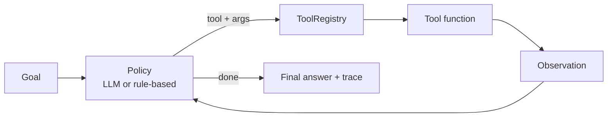

# agentkit

A compact, auditable **tool-calling agent runtime** in Python. It implements the full agent loop — decide, call tool, observe, repeat — with explicit traces, safety limits, and tool schemas ready to hand to an LLM.

## Features

- `Tool` / `ToolRegistry` with OpenAI-compatible function schemas
- Safe arithmetic tool built on `ast` (no `eval`, exponent guard)
- Deterministic `RuleBasedPolicy` planner so demos and tests need no API key
- `Trace` of every thought, tool call, arguments and observation
- Hard limits: `max_steps` and `allowed_tools`

## Quickstart

```bash
python -m agentkit.cli "Calculate 12 * 8 + 4 and explain RAG"
```

```
Registered tools: calculator, current_time, json_validate, lookup_topic, text_stats
Goal: Calculate 12 * 8 + 4 and explain RAG
1. Need to compute the expression. -> calculator({'expression': '12 * 8 + 4'}) => 100
2. Need a definition. -> lookup_topic({'topic': 'rag'}) => RAG grounds generation in retrieved documents to reduce hallucination.
Answer: RAG grounds generation in retrieved documents to reduce hallucination.
```

## Library usage

```python
from agentkit import Agent, create_default_registry

registry = create_default_registry()
print(registry.schemas())  # drop straight into an OpenAI tools= parameter

trace = Agent(registry=registry, allowed_tools=["calculator"]).run(
    "Calculate (10 + 2) * 3", max_steps=3
)
print(trace.as_lines())
```

## Architecture



## Swapping in an LLM planner

Any object with `decide(goal, registry, steps) -> (tool_name, arguments, thought) | None` is a valid policy. A real implementation can call an LLM with `registry.schemas()` and parse the tool call; the rest of the runtime stays unchanged.

## Tests

```bash
python -m unittest discover -s tests -v
```

Covers registry/schema generation, safe evaluation and rejection of unsafe expressions, all built-in tools, multi-tool traces, tool allow-lists, step limits, and the no-decision path.

## License

MIT
